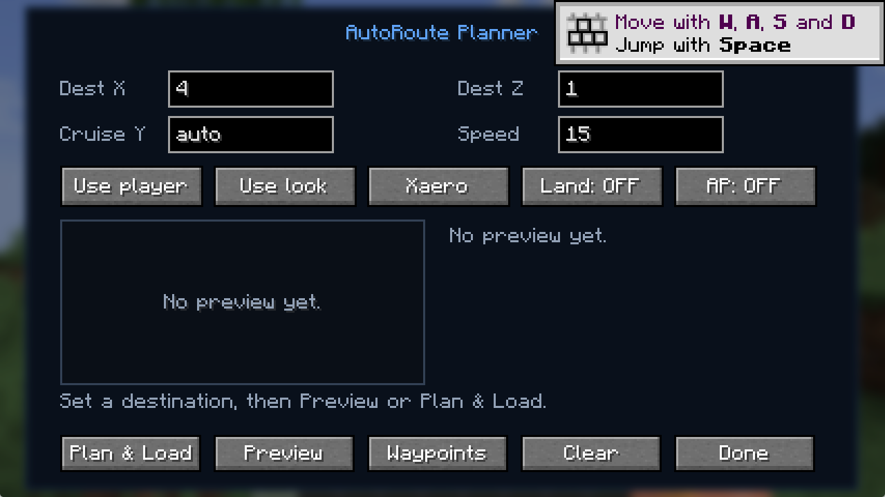
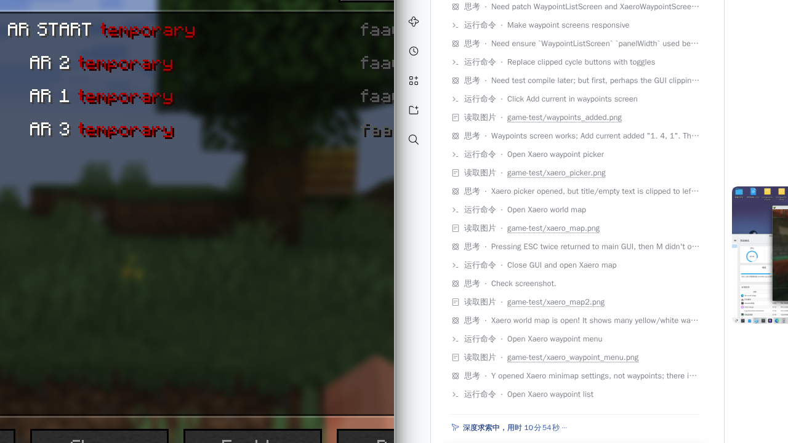

<p align="center">
  <strong>English</strong> · <a href="README.zh-CN.md">简体中文</a>
</p>

# FlightAssistant AutoRoute

A client-side **Minecraft 1.21.1 / Fabric** mod that plans terrain-aware routes for [FlightAssistant](https://modrinth.com/mod/flightassistant) and loads them directly into its flight plan (FMS).

> Not an official FlightAssistant project. Everything runs on the client; no server-side changes are required.


## Features

- **One-click route planning** — enter a destination X/Z and get climb, cruise, descent, and approach waypoints.
- **Terrain aware** — samples loaded client chunks around the route and raises the cruise altitude above the highest terrain in the corridor.
- **Auto-land** — builds a final approach and FlightAssistant arrival data, with checks for water, lava, leaves, obstacles, and steep ground.
- **Holding descent** — if the straight-line distance is too short to lose altitude, adds a descending holding pattern over the destination before the final approach.
- **Low-altitude landing protection** — near the ground, limits the final descent and applies a landing brake/flare to reduce touchdown speed. Normal cruise descent is **not** artificially slowed.
- **GUI planner** — press `F8` for a 2D preview, coordinate fields, via points, auto-land and autopilot toggles.
- **Current position as a waypoint** — add the player's current X/Z as a via point.
- **Xaero integration** — pick Xaero waypoints as destinations/via points, and publish the planned route as temporary Xaero waypoints.
- **Commands** — useful for macros and quick planning, e.g. `/autoroute land 1000 -2000 180 15`.
- **Bilingual UI** — follows the Minecraft language (English / Simplified Chinese).
- **No bundled dependencies** — the release jar does not include FlightAssistant or Fabric API.

## Requirements

| Dependency | Version |
| --- | --- |
| Minecraft | 1.21 – 1.21.1 |
| Fabric Loader | 0.16.10+ |
| Fabric API | matching 1.21.1 build |
| FlightAssistant | 3.0.x (3.0.1 recommended) |
| Architectury API | version required by FlightAssistant (13.x) |
| Fabric Language Kotlin | version required by FlightAssistant |
| Yet Another Config Lib | version required by FlightAssistant |
| Xaero's Minimap / World Map | optional, for waypoint picking and map display |

Put this mod jar and the dependencies above into `mods/`. Xaero is optional; without it, only the map integration is unavailable.

## Installation

1. Install Fabric Loader for Minecraft 1.21.1.
2. Install Fabric API and FlightAssistant with its required dependencies.
3. Put `faautoroute-<version>+mc1.21.1.jar` into `.minecraft/mods/`.
4. Launch the Fabric profile. The mod is client-side only.

## Usage

### GUI

1. Press `F8`, or run `/autoroute` / `/autoroute gui`.
2. Enter the destination **X** and **Z**.
3. Leave **Cruise Y** empty for automatic terrain-aware altitude, or enter a fixed altitude.
4. **Speed** is FlightAssistant's target speed in blocks/second; `0` means "do not manage speed".
5. Optional toggles:
   - **Auto land** — build the full approach and landing plan.
   - **Arm AP** — engage FlightAssistant autopilot and auto-throttle after loading.
6. **Preview** only previews; **Plan & Load** writes the plan into FlightAssistant.
7. **Use player** sets the destination to the current position; **Use look** targets the block you are looking at (up to 384 blocks).
8. **Xaero** opens the Xaero waypoint picker.
9. **Waypoints** manages via points:
   - **Add current** adds the current X/Z.
   - **Add Xaero** adds an Xaero waypoint.
   - Click a listed via point to remove it.
10. A successful plan is published as temporary Xaero waypoints. **Clear** also removes the FlightAssistant plan, via points, and temporary Xaero route.

The right side of the GUI shows the route preview, distance, cruise altitude, waypoint count, via count, ETA, and terrain warnings.



### Commands

| Command | Description |
| --- | --- |
| `/autoroute` | Open the GUI |
| `/autoroute gui` | Open the GUI |
| `/autoroute here` | Open the GUI with the looked-at block as destination |
| `/autoroute addhere` | Add the current position as a via point |
| `/autoroute waypoints` | Open the via-point manager |
| `/autoroute clearvia` | Clear all via points |
| `/autoroute plan <x> <z> [cruise] [speed]` | Plan an overflight route and load it |
| `/autoroute land <x> <z> [cruise] [speed]` | Plan with auto-land |
| `/autoroute ap` | Engage autopilot and auto-throttle on the loaded plan |
| `/autoroute clear` | Clear the FlightAssistant plan and disconnect autopilot |
| `/autoroute info` | Show waypoint count and arrival information |
| `/autoroute <x> <z> [cruise] [speed]` | Shortcut for `/autoroute plan` |

`cruise` accepts `-120..1200`; `speed` accepts `0..30`.

### Xaero

- Use **Xaero** in the GUI to pick a destination or a via point.
- The planned route is shown as temporary waypoints named `AR START`, `AR 1`, `AR 2`, … and `AR DEST`.
- Clearing the route removes those temporary waypoints.



## How planning works

1. The route is a polyline from the current position through all via points to the destination.
2. Each leg is sampled every 24 blocks. At each sample, the `MOTION_BLOCKING_NO_LEAVES` heightmap is read at offsets `-48`, `-24`, `0`, `+24`, `+48` blocks.
3. The highest terrain in the corridor plus a safety clearance determines the cruise altitude. The Nether roof is handled separately.
4. A climb/track-establishment waypoint is added first, then cruise waypoints every 512 blocks; each via point gets a turn waypoint.
5. The top of descent (TOD) is calculated from the descent rate and final approach geometry.
6. With auto-land enabled, a final approach is placed 120–450 blocks before the destination and the aircraft follows a roughly 1:10 glide path.
7. FlightAssistant `ArrivalData` is written with elevation, minimums, go-around altitude, and re-entry waypoint.
8. If the remaining distance cannot support the descent, a descending holding pattern is inserted over the destination.
9. Near touchdown, the mod limits the final descent and applies a landing brake/flare to reduce touchdown speed.

> This mod is compiled against FlightAssistant **3.0.x** flight-plan internals. A major FlightAssistant update may require an adapter update.

> Only loaded client chunks are sampled. Unloaded areas use conservative altitudes and produce a warning. For long routes across unloaded terrain, scout the area or split the route.

## Auto-land limitations

Auto-land only checks terrain height and slope. It cannot guarantee:

- no buildings, trees, or other collision shapes above the target;
- the target is not a village, fortress, or other protected structure;
- the server allows flight and does not run anti-cheat restrictions;
- your Elytra and fireworks are sufficient for the approach.

Test in creative mode or a safe area first. Autopilot is **off by default**; it is only engaged when you explicitly use **Arm AP** or `/autoroute ap`.

Auto-land is not available in the Nether: the vanilla heightmap returns the bedrock roof, so the mod only plans overflight routes there.

## Build from source

JDK 21 is required. Use the Gradle wrapper:

```bash
./gradlew build
```

The jar is written to `build/libs/faautoroute-<version>+mc1.21.1.jar`.

The first build downloads Minecraft, mappings, and dependencies. If your network needs a proxy, configure it in your Gradle user home (`GRADLE_USER_HOME/gradle.properties`).

## Project layout

```text
src/main/java/com/water500t/faautoroute/
  AutoRouteClient.java      Client entrypoint, keybind, FlightAssistant bus hook
  AutoRouteCommands.java    /autoroute command tree
  RoutePlanner.java         Terrain sampling, route and approach generation
  RoutePlannerScreen.java   Main GUI
  WaypointListScreen.java   Via-point manager
  XaeroWaypointScreen.java  Xaero waypoint picker
  XaeroIntegration.java     Xaero third-party waypoint bridge (reflection)
  RouteOptions.java         Planning options
  RoutePoint.java           Via point
  RouteResult.java          Planning result / preview data
  RoutePlanningException.java
src/main/resources/assets/faautoroute/lang/   English / Chinese translations
```

## License

MIT. FlightAssistant itself is licensed under LGPL-3.0; this project interacts with its public/accessible API and does not include its code.
