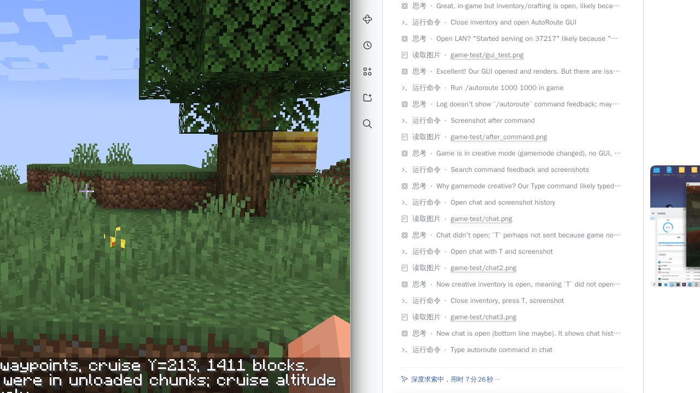

# FlightAssistant AutoRoute

一个面向 **Minecraft 1.21.1 / Fabric** 的客户端模组：为 [FlightAssistant](https://modrinth.com/mod/flightassistant) 自动规划地形感知航线，并把航点直接写入 FlightAssistant 的飞行计划（FMS）。

> 不是 FlightAssistant 官方项目，也不修改服务端。所有规划都在客户端完成。

## 功能

- **一键自动规划**：输入目标 X/Z，自动生成爬升、巡航、下降和进近航点。
- **地形感知**：沿航线左右各 48 格采样客户端已加载区块的高度图，自动选择安全巡航高度。
- **自动降落（可选）**：生成最后进近航段和 FlightAssistant 的到达数据；降落前检查目标是否在水、岩浆、树叶、障碍物或过陡地形上。
- **GUI 规划器**：`F8` 打开，可直接输入坐标、预览 2D 航线、选择是否自动降落和是否接通自动驾驶。
- **途经点**：可把当前坐标加入航线，按顺序经过多个途经点后再到目标。
- **Xaero 联动**：读取 Xaero 航点作为目标或途经点；规划结果会作为临时航线显示在 Xaero 小地图/世界地图上。
- **游戏内命令**：适合宏或快速操作，例如 `/autoroute 1000 -2000 180 15`。
- **中英双语**：跟随游戏语言显示。
- **不捆绑依赖**：发布 jar 不包含 FlightAssistant 或 Fabric API。

## 环境要求

| 依赖 | 版本 |
| --- | --- |
| Minecraft | 1.21 / 1.21.1 |
| Fabric Loader | >= 0.16.10 |
| Fabric API | 1.21.1 对应版本 |
| FlightAssistant | >= 3.0.0（推荐 3.0.1） |
| Architectury API | FlightAssistant 所需版本（13.x） |
| Fabric Language Kotlin | FlightAssistant 所需版本 |
| Yet Another Config Lib | FlightAssistant 所需版本 |
| Xaero's Minimap / World Map | 可选；用于航点选择与航线显示 |

把本模组 jar 和上述依赖一起放进 `mods/` 即可。Xaero 不安装时模组仍可正常使用，只是没有地图联动。

## 使用

### GUI

1. 按 `F8`，或输入 `/autoroute` / `/autoroute gui`。
2. 填写目标 `X`、`Z`。
3. `Cruise Y` 留空表示自动选择巡航高度；也可以手动指定。
4. `Speed` 是 FlightAssistant 的目标速度（格/秒，0 表示不管理速度）。
5. 可选：
   - `Auto land`：生成完整进近和降落计划。
   - `Arm AP`：加载计划后同时接通 FlightAssistant 的自动驾驶和自动油门。
6. 点 `Preview` 只预览，点 `Plan & Load` 写入 FlightAssistant。
7. `Use player` 把目标设为当前位置；`Use look` 把目标设为视线所指方块（最远 384 格）。
8. `Xaero` 打开 Xaero 航点选择器，点一个航点即可把它设为目的地。
9. `Waypoints` 打开途经点管理：
   - `Add current` 把当前坐标加入航线（作为起点航点）。
   - `Add Xaero` 从 Xaero 航点中选择一个加入途经点。
   - 点击列表中的途经点可移除；也可以移除最后一个或清空。
10. 规划成功后，路线会自动作为临时航点显示在 Xaero 地图上；点 `Clear` 会同时清除 FlightAssistant 计划、途经点和 Xaero 临时航线。

GUI 右侧会显示航线预览、距离、巡航高度、航点数、途经点数、预计时间和地形警告。

### 命令

| 命令 | 作用 |
| --- | --- |
| `/autoroute` | 打开 GUI |
| `/autoroute gui` | 打开 GUI |
| `/autoroute here` | 打开 GUI，目标预填为视线所指方块 |
| `/autoroute addhere` | 把当前坐标加入途经点 |
| `/autoroute waypoints` | 打开途经点管理界面 |
| `/autoroute clearvia` | 清空途经点 |
| `/autoroute <x> <z>` | 自动规划过境航线并加载 |
| `/autoroute <x> <z> <cruise>` | 指定巡航高度 |
| `/autoroute <x> <z> <cruise> <speed>` | 指定巡航高度和目标速度 |
| `/autoroute land <x> <z> [cruise] [speed]` | 生成带自动降落的航线 |
| `/autoroute clear` | 清除 FlightAssistant 飞行计划并断开自动驾驶 |
| `/autoroute info` | 查看当前航点数和到达点 |

命令中的 `cruise` 范围是 `-120..1200`，`speed` 范围是 `0..30`。

## 规划逻辑

1. 从当前位置依次经过所有途经点，最后到达目标，形成折线航迹。
2. 沿每一段航迹每 24 格采样一次，并在横向 `-48/-24/0/+24/+48` 格处读取 `MOTION_BLOCKING_NO_LEAVES` 高度图。
3. 取航线走廊内最高地形，加上至少 50 格净空，得到安全巡航高度；下界会将上限限制在 Y=118。
4. 生成第一个航点作为爬升/航迹建立点，之后每 512 格一个巡航航点；每个途经点都会生成一个转弯航点。
5. 根据下降率计算下降顶点（TOD），插入下降段。
6. 自动降落时，在目标前 120–450 格建立最后进近点，按约 1:10 下滑角下降到目标；同时写入 FlightAssistant 的 `ArrivalData`（标高、最低高度、复飞高度、复飞重入航点）。
7. 第一个航点标记为 `TARGET`；如果显式添加了“当前坐标”作为途经点，它会被标记为 `ORIGIN`，下一个航点为 `TARGET`。

> 本模组针对 FlightAssistant **3.0.x** 的飞行计划数据结构编译；FlightAssistant 大版本更新后可能需要重新适配。

> 注意：规划只读取客户端已加载的区块。未加载区域会使用保守高度并显示警告；跨未加载区域的长航线仍然建议先低空探路或分段规划。

## 自动降落的限制

自动降落只保证“地形高度和坡度”层面的可行性，不能保证：

- 目标上空没有建筑、树叶或其它碰撞体；
- 目标不是村庄/要塞等不可破坏结构；
- 服务器没有飞行限制或反作弊；
- 你的 Elytra 和烟花足够完成进近。

建议先在创造模式或安全场地测试。模组默认不接通自动驾驶，只有显式勾选 `Arm AP` 才会接管。

下界无法使用自动降落：原版高度图在屋顶下方会返回顶部基岩高度，不能可靠判断地面，因此本模组在下界只提供过境航线。


## 实机测试记录

已在独立的 Minecraft 1.21.1 / Fabric 测试实例中实际启动客户端并进入世界验证：

- `F8` 能打开规划器，紧凑窗口下按钮和标签完整显示。
- `/autoroute 1000 1000` 成功生成并加载 `3` 个航点，巡航高度 `Y=213`，总距离 `1411` 格。
- 未加载区块警告正常显示，巡航高度按保守值抬高。
- `Waypoints → Add current` 成功添加当前坐标（如 `1. 4, 1`）。
- Xaero 航点选择器可以打开；Xaero 航点列表中出现 `AR START`、`AR 1`、`AR 2`、`AR 3` 临时航点，证明地图联动生效。
- `Land` / `AP` 开关可正常切换。





> 已测试范围是客户端启动、GUI、航点生成、FlightAssistant 计划写入和 Xaero 地图显示；没有实际用 Elytra 飞完整条航线，也没有在生存模式下测试自动降落。

## 从源码构建

要求 JDK 21。项目使用 Gradle Wrapper：

```bash
./gradlew build
```

产物在 `build/libs/faautoroute-1.1.7+mc1.21.1.jar`。仓库里也放了一份预编译版本：`dist/faautoroute-1.1.7+mc1.21.1.jar`。

开发环境首次构建需要下载 Minecraft、Mappings 和依赖。若网络需要代理，可在 `GRADLE_USER_HOME/gradle.properties` 中配置：

```properties
systemProp.http.proxyHost=127.0.0.1
systemProp.http.proxyPort=7897
systemProp.https.proxyHost=127.0.0.1
systemProp.https.proxyPort=7897
```

## 项目结构

```
src/main/java/com/water500t/faautoroute/
  AutoRouteClient.java     客户端入口、按键、FlightAssistant 总线捕获
  AutoRouteCommands.java   /autoroute 命令树
  RoutePlanner.java        多段地形采样与航点生成
  RoutePlannerScreen.java  主 GUI
  WaypointListScreen.java  途经点管理界面
  XaeroWaypointScreen.java Xaero 航点选择器
  XaeroIntegration.java    Xaero 地图联动（反射调用第三方航点 API）
  RouteOptions.java        规划参数
  RoutePoint.java          途经点
  RouteResult.java         规划结果与预览数据
  RoutePlanningException.java
src/main/resources/assets/faautoroute/lang/  中英文翻译
```

## 许可

MIT。FlightAssistant 本身使用 LGPL-3.0，本项目仅通过其公开/可访问 API 交互，不包含其代码。
